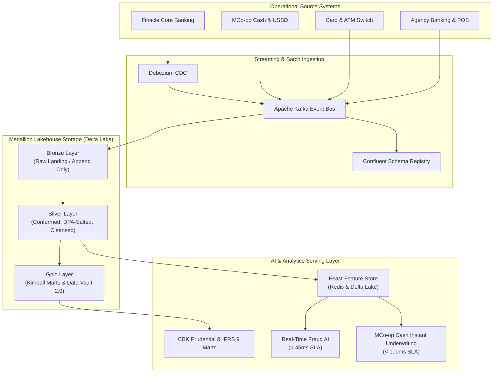

# The Co-operative Bank of Kenya — AI & Data Architecture Platform

**Target Role:** AI & Data Architect  
**Job Reference:** `AI Data – A/IID/2026`  
**Reporting to:** Head – Artificial Intelligence  
**Application Deadline:** November 9th, 2026  
**Candidate:** Roy Nganga Khaemba  
**Live Platform:** [https://coopbank-ai-data-architect.fly.dev](https://coopbank-ai-data-architect.fly.dev)  
**GitHub Repository:** [https://github.com/peddipedderu/coopbank-ai-data-architect](https://github.com/peddipedderu/coopbank-ai-data-architect)  
**Hugging Face:** [https://huggingface.co/peddipedderu](https://huggingface.co/peddipedderu)  
**Kaggle:** [https://www.kaggle.com/peddipedderu](https://www.kaggle.com/peddipedderu)  
**LinkedIn:** [https://linkedin.com/in/roy-khaemba](https://linkedin.com/in/roy-khaemba)  

---

## 🏛️ Executive Architectural Summary

This repository presents the enterprise reference architecture designed specifically for **The Co-operative Bank of Kenya** to support its digital transformation and artificial intelligence modernization roadmap. 

As the Bank expands its AI use cases across **MCo-op Cash digital banking**, real-time credit underwriting, transactional fraud detection, customer 360 intelligence, and statutory compliance (Central Bank of Kenya prudential returns and IFRS 9 ECL), this architecture establishes the foundation:
1. **Medallion Lakehouse Platform (Bronze, Silver, Gold, Feast Feature Store)** utilizing Delta Lake and Apache Spark to eliminate redundant storage silos and guarantee ACID consistency.
2. **Sub-second Event Streaming** utilizing Apache Kafka and Apache Flink to capture core banking mutations (Finacle), mobile app events, and ATM switch signals with zero data loss.
3. **Data Governance & Privacy-by-Design** fully aligned with the **Kenya Data Protection Act, 2019**, BCBS 239 risk data principles, and DAMA-DMBOK standards.
4. **Architecture Review Board (ARB) Governance** with documented Architecture Decision Records (ADRs) and clear technical debt remediation roadmaps.

---

## 📐 Enterprise Target-State Architecture Flow



---

## 🛡️ Kenya Data Protection Act, 2019 (DPA) Compliance Matrix

| Regulation Section | Requirement | Architectural Implementation |
| :--- | :--- | :--- |
| **Section 25** | Pseudonymization & Encryption of PII | Irreversible HMAC-SHA256 hashing for national ID & phone numbers; AES-256 encryption at rest; TLS 1.3 in transit. |
| **Section 40** | Right to Erasure (Right to be Forgotten) | Delta Lake ACID `MERGE` & `DELETE` operations combined with cryptographic key shredding. |
| **Section 30** | Purpose Limitation & Minimization | Attribute-Based Access Control (ABAC) ensuring AI squads only access de-identified feature stores. |
| **Section 41** | Automated Processing & Profiling | Transparent feature lineage with SHAP explainability matrices for all automated credit decisioning. |

---

## 🔌 API Endpoints & Verification

The platform exposes production REST endpoints for health checks and architectural introspection:

- `GET /api/health` — Container health and subsystem availability check.
- `GET /api/candidate` — Candidate qualifications, contact details, and portfolio URLs.
- `GET /api/architecture/pillars` — Comprehensive lakehouse and streaming architectural definitions.
- `GET /api/architecture/data-models` — Conceptual, logical, and physical Delta Lake DDL models.
- `GET /api/architecture/lineage` — Graph nodes and edges tracing Finacle to AI feature consumption.
- `GET /api/architecture/adrs` — Architecture Decision Records approved for Co-op Bank.

---

## 🚀 Running Locally

```bash
# Clone the repository
git clone https://github.com/peddipedderu/coopbank-ai-data-architect.git
cd coopbank-ai-data-architect

# Install dependencies
pip install -r requirements.txt

# Start the application on custom port (e.g. 8088)
python main.py
```

Visit `http://localhost:8088` in your browser.

---

## ☁️ Deployment on Fly.io

```bash
# Deploy to Fly.io
fly launch --name coopbank-ai-data-architect --region jnb --no-deploy
fly deploy
```

---

## 👤 Candidate Profile

- **Name:** Roy Nganga Khaemba  
- **Education:** Bachelor of Science in Actuarial Science & Statistics, Dedan Kimathi University of Technology  
- **Certifications:** WorldQuant IQC 2026 Stage 1, Certified Data Management Practitioner  
- **Email:** roykhaemba00@gmail.com  
- **Tel:** +254 743 192 968  
- **Location:** Nairobi, Kenya  
